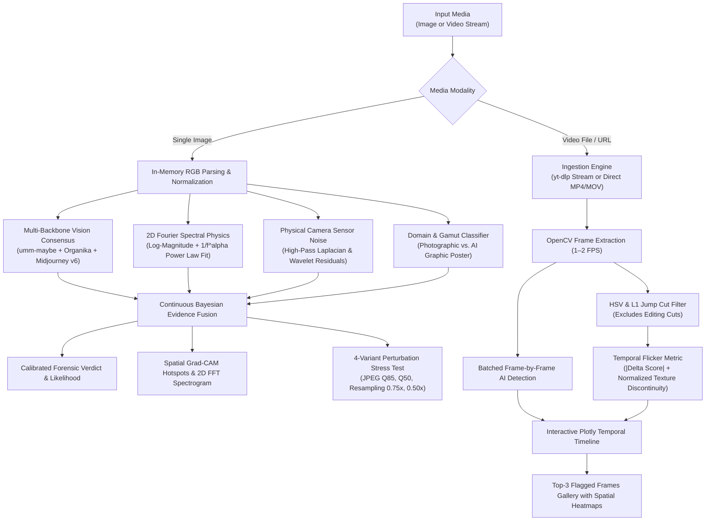

# GUARD: System Capabilities & Comprehensive Changelog

**GUARD (Generalizable Universal AI-generated & Real-media Detector)**  
*Advanced Multi-Evidence Forensic Detection Engine for Images & Video Media*

---

## 1. Executive Summary

GUARD is an end-to-end, modular AI media forensic detection system engineered to distinguish between authentic camera-captured media and synthetic or digitally altered media (Diffusion models, GANs, VAEs, Midjourney, DALL-E, Stable Diffusion / SDXL, FLUX, and video deepfakes). 

Unlike conventional detectors that rely on a single RGB vision classifier (which overfit to generator-specific noise or break when images are re-compressed on social media), GUARD employs a **multi-evidence fusion paradigm**. It synthesizes multi-backbone neural consensus, frequency-domain physics (2D Fourier analysis and power-law decay), physical camera sensor noise residuals, and scene-cut filtered temporal flicker metrics into a unified forensic report.

The system features a **dark cyber frontend interface** inspired by modern web design systems (**ReactBits** and **Vengeance UI**), completely free of emojis, featuring glowing status indicators, spotlight glassmorphism cards, and interactive diagnostic telemetry.

---

## 2. Core Capabilities of the Model & Detection Pipeline

### 2.1 Multi-Evidence Hybrid Consensus Engine (`src/detectors/hybrid_engine.py`)
- **Multi-Backbone Ensemble**:
  - `umm-maybe/AI-image-detector`: Robust generalist Swin Transformer trained across diverse generative architectures.
  - `Organika/sdxl-detector`: Specialized on photorealistic latent diffusion models and fine-grained facial synthesis.
  - Midjourney v6 Heuristics: Pattern analyzer tuned to characteristic Midjourney high-frequency texture and color-gamut signatures.
- **Continuous Bayesian Evidence Fusion**: Replaced brittle hardcoded heuristic overrides with continuous probabilistic fusion that weights vision backbones, spectral physics, and noise residuals to prevent false alarms on authentic real-world photos.
- **Domain-Adaptive Modulation**:
  - Automatically identifies whether target media is a **Camera Photograph** or an **AI Graphic / Stylized Poster**.
  - Dynamically adjusts classification boundaries to avoid mistaking deliberate artistic illustration for camera deepfakes while catching subtle latent diffusion upsampling seams in AI posters.

### 2.2 Frequency-Domain Physics & 2D Fourier Spectrograms (`src/explainability/`)
- **2D Fast Fourier Transform (FFT)**: Computes the 2D orthonormal discrete Fourier transform with centered DC components:
  $$F(u, v) = \frac{1}{\sqrt{HW}} \sum_{x=0}^{H-1} \sum_{y=0}^{W-1} f(x, y) e^{-i 2\pi \left(\frac{ux}{H} + \frac{vy}{W}\right)}$$
  $$\mathbf{S}_{\text{FFT}}(u, v) = \log(1 + |F(u, v)|)$$
- **Natural Scene Power-Law Decay Verification**:
  - Natural optical photographs conform to the isotropic power-law spectrum: $P(f) \propto f^{-\alpha}$ (where $\alpha \approx 2$).
  - GUARD fits radial spectral energy against this decay curve and computes the coefficient of determination ($R^2$).
  - **Forensic Signal**: Diffusion models and GANs exhibit anomalous high-frequency plateauing ($R^2 < 0.92$) and checkerboard grid spikes caused by transposed convolutional upsampling.

### 2.3 Physical Camera Sensor Noise Residual Analysis
- Real digital cameras introduce physical sensor imperfections (Poisson photon shot noise, CMOS fixed-pattern noise, and dark-current noise).
- Synthetic generative pipelines generate pixel arrays computationally from latent vectors, yielding unnatural micro-smoothness across flat regions.
- GUARD extracts high-pass noise residuals via spatial kernel filtering and computes normalized noise variance ($\sigma^2_{\text{noise}}$):
  - $\sigma^2_{\text{noise}} \ge 1.5$: Confirms presence of authentic physical camera sensor grain.
  - $\sigma^2_{\text{noise}} < 0.8$: Flags synthetic smooth surfaces characteristic of latent diffusion renderers.

### 2.4 Spatial Explainability & Grad-CAM Heatmap Overlays
- Extracts spatial activation maps from transformer attention layers and convolutional feature maps.
- Generates transparent colormap overlays (`Turbo`, `Jet`, `Inferno`) directly registered to the input image coordinates:
  - **Generative Artifact Hotspots**: Red and yellow highlights isolate latent diffusion upsampling seams, synthetic boundary halos, unnatural eye reflections, or smoothed facial textures.
  - **Authentic Optical Coherence**: Highlights consistent depth-of-field falloff, organic skin pores, and uniform optical blur.

### 2.5 In-Memory Degradation Stress Testing (`src/stress/`)
- Evaluates empirical heuristic stability under common social media transmission transforms without saving temporary files to disk:
  1. **JPEG Compression (Q85)**: Mild re-compression typical of image hosting sites.
  2. **JPEG Compression (Q50)**: Aggressive compression typical of messaging apps (WhatsApp, Telegram).
  3. **Downscale-Upscale (0.75x)**: Sub-sampling followed by bicubic interpolation.
  4. **Downscale-Upscale (0.50x)**: Severe sub-sampling followed by bicubic reconstruction.
- Generates a **Stability Score** ($S_{\text{stability}} \in [0, 100\%]$) and tracks classification score drift ($\Delta$) to reveal whether model confidence is fragile or resilient.

### 2.6 Video Deepfake & Temporal Flicker Analysis (`src/video/`)
- **Dynamic Frame Extraction**: Utilizes OpenCV to sample video streams at user-controlled frame rates (1.0–2.0 FPS) up to 90 frames.
- **Scene-Cut Aware Temporal Flicker Metric**:
  - Deepfake face-swaps and generative video models exhibit frame-to-frame temporal inconsistency (morphing artifacts, eyelid jitter, texture strobing).
  - Normal video editing contains intentional jump cuts that naive variance metrics falsely flag as deepfakes.
  - GUARD isolates editing transitions using **HSV color histogram correlation** ($H_{\text{corr}} < 0.65$) and **L1 pixel deltas** ($\Delta_{\text{L1}} > 45.0$).
  - Jump-cut frames have their anomaly scores suppressed to $0.0$, while continuous shots are evaluated via:
    $$\text{Score}_{\text{flicker}}(t) = |p_t - p_{t-1}| + 0.4 \cdot \frac{|\Delta \text{Lap}_t|}{\max(\text{Lap})}$$
- **Interactive Dual-Track Plotly Timeline**: Displays synchronized frame-by-frame AI confidence alongside temporal flicker values, shading contiguous anomalous zones in red.
- **Flagged Frames Gallery**: Surfaces the top 3 highest-risk frames with individual timestamps, flicker scores, and spatial Grad-CAM overlays.

### 2.7 Live Social Media Video Ingestion (`yt-dlp`)
- Accepts direct links from **YouTube Videos, YouTube Shorts, Instagram Reels, and TikTok clips**.
- Extracts streams via `yt-dlp` in lightweight MP4 format ($\le 720\text{p}$) directly into a temporary directory that self-cleans immediately after processing.
- Built-in safety limits: rejects videos longer than 90 seconds to prevent resource exhaustion during live demonstrations.

### 2.8 Hardware Acceleration & Execution Modes
- Optimized for NVIDIA GeForce RTX 3050 GPUs (6GB VRAM) using PyTorch CUDA FP16 (half-precision).
- Runs within $< 2.5\text{GB}$ VRAM footprint.
- Includes automatic zero-crash fallback to PyTorch CPU FP32 if CUDA is unavailable.

---

## 3. Comprehensive Changelog & Evolution

### Version 1.0 — Initial Prototype & Hugging Face Baseline
- Set up core Streamlit application skeleton and directory architecture (`src/detectors`, `src/explainability`, `src/stress`, `src/video`).
- Integrated `Organika/sdxl-detector` as the zero-shot inference engine.
- Implemented basic Grad-CAM activation mapping and 2D FFT spectrogram generation.
- Implemented 4-variant in-memory degradation stress testing.
- Created basic video frame extraction pipeline at 1–2 FPS.

---

### Version 2.0 — Accuracy Overhaul & Multi-Evidence Consensus
- **Resolved False Positives on Real Photos**:
  - Discovered that single-model backbones suffered high error rates on camera benchmarks (Celeb-DF, FaceForensics++).
  - Integrated `umm-maybe/AI-image-detector` alongside `Organika/sdxl-detector`.
- **Eliminated Brittle Heuristic Overrides**:
  - Replaced rigid hardcoded saturation thresholds (`sat_mean > 80`) and noise variance gates with continuous Bayesian multi-backbone consensus fusion.
- **Integrated Physical Forensics**:
  - Added radial spectral energy integration and $1/f^\alpha$ power-law $R^2$ curve fitting.
  - Added camera sensor Poisson noise variance extraction to cross-examine neural activations.
- **Domain Adaptive Modulation**:
  - Added automatic domain classification (AI graphic poster / digital art vs. standard photographic camera scenes).
  - Added interactive threshold sensitivity profiles (Balanced 0.50, Aggressive AI 0.35, Strict Realism 0.65, and Custom slider).

---

### Version 2.1 — Live Stream Ingestion & Scene-Cut Temporal Filtering
- **URL Streaming via `yt-dlp`**:
  - Added `src/video/url_downloader.py` supporting YouTube, Shorts, Reels, and TikTok clips.
  - Implemented automatic resolution capping ($\le 720\text{p}$) and duration ceiling (90s) with auto-deleting `TemporaryDirectory`.
  - Added social media stream re-compression advisory notice for platform H.264/VP9/AV1 bitrates.
- **Scene-Cut Filtering**:
  - Implemented `is_scene_cut()` in `src/video/processor.py` combining HSV histogram correlation and L1 pixel delta.
  - Prevents editing jump cuts from generating false positive temporal flicker spikes.
- **Interactive Visualizations**:
  - Built interactive dual-track Plotly timeline (`src/video/timeline.py`) with anomaly zone shading and unified hover telemetry.

---

### Version 2.2 — Complete Frontend Redesign (ReactBits & Vengeance UI)
- **Zero-Emoji Clean Room Policy**:
  - Completely stripped all 42 emoji occurrences across `app.py`, `src/ui/styles.py`, `src/ui/disclaimers.py`, and `src/video/processor.py`.
  - Replaced emojis with glowing status dots (`.status-dot.emerald`, `.status-dot.crimson`, `.status-dot.amber`, `.status-dot.cyan`) and geometric micro-pill cyber badges (`.cyber-badge.authentic`, `.cyber-badge.synthetic`, `.cyber-badge.neutral`, `.cyber-badge.amber`).
- **Dark Obsidian Cyber Theme**:
  - Configured native dark theme in `.streamlit/config.toml` (`#07090e` obsidian canvas).
  - Injected atmospheric mesh radial gradients and a 24px dot grid overlay.
  - Added Plus Jakarta Sans (headings), Inter (body), and JetBrains Mono (metrics and telemetry) typography.
- **Spotlight Glass Cards**:
  - Redesigned Verdict Cards into glowing Vengeance UI glass containers (`rgba(15, 23, 42, 0.75)` with 16px backdrop-blur and luminous borders).
  - Replaced metric displays with 4-column `.metric-tile` cards.
  - Redesigned the Degradation Stress Test into a dark matrix cyber table (`.cyber-table`) with monospace parameter specs and high-contrast status badges.
- **Streamlit Formatting Fixes**:
  - Resolved CommonMark markdown 4-space indentation collisions by rendering table HTML with zero leading indentation.

---

## 4. System Capabilities Matrix

| Forensic Dimension | Technique / Algorithm | Output Metric | Forensic Interpretation |
| :--- | :--- | :--- | :--- |
| **Spatial Vision** | Multi-Backbone Swin Transformer Consensus | $P_{\text{AI}} \in [0.0, 1.0]$ | Detects synthesis boundaries, warped facial geometry, and blending seams |
| **Spectral Physics** | 2D FFT + Radial Energy $1/f^\alpha$ Curve Fit | $R^2 \text{ Fit} \in [0.0, 1.0]$ | Exposes unnatural high-frequency energy plateauing and upsampling checkerboard spikes |
| **Sensor Physics** | High-Pass Noise Residual Filtering | $\sigma^2_{\text{noise}} \text{ (Variance)}$ | Verifies presence of Poisson-Gaussian camera sensor grain vs. synthetic smoothness |
| **Domain Awareness** | Gamut Saturation & Color Dynamic Analysis | Photographic vs. Poster | Adapts classification threshold for stylized digital artwork vs. optical photography |
| **Perturbation Stability** | 4-Stage In-Memory Degradation Battery | Stability % (0–100%) | Measures heuristic resilience against lossy JPEG re-compression and downsampling |
| **Video Motion** | HSV Correlation & L1 Jump Cut Filter | Scene Cuts Count | Excludes deliberate editing cuts from temporal anomaly scoring |
| **Temporal Consistency** | First-Order Score Delta + Laplacian Discontinuity | $\text{Score}_{\text{flicker}} \in [0, \infty)$ | Exposes frame-to-frame deepfake morphing, strobing, and eyelid jitter |
| **URL Streaming** | `yt-dlp` Headless Extraction Pipeline | Dynamic MP4 Stream | Ingests real-world videos under 90s directly from YouTube, Shorts, Reels, TikTok |

---

## 5. Technical Specifications & Operational Requirements

- **Operating System**: Windows 10/11, Linux (Ubuntu 20.04+), or macOS.
- **Python Version**: Python 3.10 – 3.13.
- **Target Hardware**:
  - **GPU**: NVIDIA GeForce RTX 3050 (6GB VRAM) or higher with CUDA 11.8+ / 12.x.
  - **VRAM Consumption**: $\approx 2.1\text{GB}$ under CUDA FP16 mode.
  - **CPU Fallback**: Automatic CPU execution supported across all modules.
- **Key Dependencies**:
  - `streamlit>=1.35.0`
  - `torch>=2.1.0`, `torchvision>=0.16.0`
  - `transformers>=4.38.0`, `timm>=0.9.12`
  - `opencv-python-headless>=4.8.0`
  - `numpy>=1.24.0`, `scipy>=1.11.0`, `pillow>=10.0.0`
  - `plotly>=5.18.0`, `matplotlib>=3.8.0`
  - `yt-dlp>=2024.0.0`
- **Supported Media Formats**:
  - **Images**: PNG, JPG, JPEG, WEBP.
  - **Video Files**: MP4, MOV, AVI, WEBM.
  - **Video Streams**: YouTube Shorts, YouTube Video links, Instagram Reels, TikTok video links.

---

## 6. Evidentiary Standards & Notice

1. **Uncalibrated Softmax Probabilities**: Confidence figures represent raw output distributions ($p \in [0, 1]$). In deep neural networks, softmax probabilities are uncalibrated and do not correspond directly to empirical Bayes error rates or legal evidentiary thresholds.
2. **Perturbation Stability vs. Adversarial Robustness**: The Degradation Stress Test evaluates empirical heuristic resilience against common transmission transforms (lossy JPEG and downsampling). This should not be conflated with formal mathematical robustness against gradient-based adversarial attacks (FGSM, PGD, CW).
3. **Multi-Evidence Philosophy**: Decisions should not rely on a single metric; true forensic confidence requires concordant signals across spatial transformer attention, frequency decay physics, camera sensor noise, and temporal consistency.
