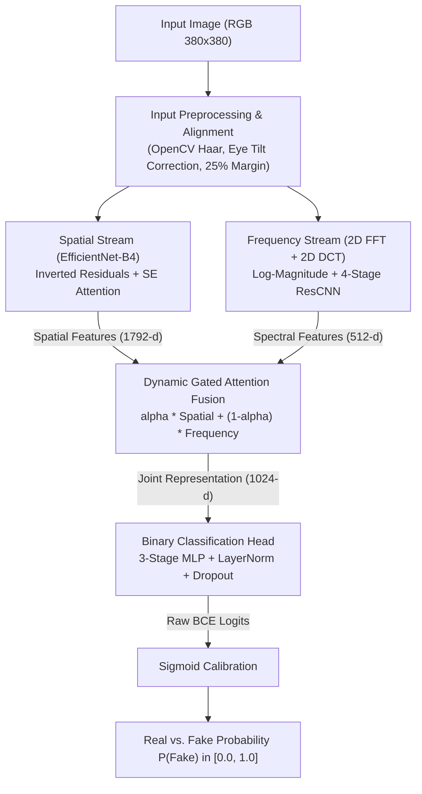

# GUARD: Machine Learning Architecture & Algorithm Specification

## 1. High-Level Paradigm & System Overview

**GUARD (Generalizable Universal AI-generated & Real-image Detector)** is a **Dual-Stream Multi-Modal Deep Neural Network** designed to detect deepfakes, AI-generated imagery (GANs, Diffusion, VAEs), and digital facial manipulations.

Traditional detectors rely solely on RGB pixel representations (which easily overfit to generator artifacts or break under social media compression). GUARD addresses this by pairing a **Spatial Convolutional Attention Network** with a **Differentiable Frequency Spectral Residual Network**, dynamically balanced through **Gated Attention Fusion**.

---

## 2. Core Architectural Components & Mathematical Formulations

### Stage 1: Spatial Stream (`src/models/spatial_stream.py`)
- **Base Architecture**: `EfficientNet-B4` (pre-trained on ImageNet-1k via `timm`).
- **Core Mechanism**:
  - **MBConv (Mobile Inverted Bottleneck Convolution)**: Uses depthwise separable convolutions to extract high-capacity features with minimal parameter bloat.
  - **Squeeze-and-Excitation (SE) Attention**: Adaptively recalibrates channel-wise feature responses by explicitly modeling interdependencies between channels.
  - **In-Graph Normalization**:
    $$\mathbf{x}_{\text{norm}} = \frac{\mathbf{x} - \mathbf{\mu}_{\text{ImageNet}}}{\mathbf{\sigma}_{\text{ImageNet}}}$$
    Embedded directly in the computation graph to guarantee identical normalization across training, evaluation, and live inference.
- **Forensic Focus**: Detects pixel-level blending boundaries, face-warping artifacts, anatomical asymmetry, and synthetic skin micro-texture discontinuities.
- **Outputs**:
  - **Global Pooled Vector**: $\mathbf{f}_{\text{spatial}} \in \mathbb{R}^{1792}$
  - **2D Convolutional Feature Maps**: $\mathbf{M}_{\text{spatial}} \in \mathbb{R}^{1792 \times 12 \times 12}$ (used for Grad-CAM / spatial activation heatmap overlays).

---

### Stage 2: Frequency Stream (`src/models/frequency_stream.py`)
- **Forensic Rationale**: Generative models rely on transposed convolutions and upsampling layers that inevitably leave periodic high-frequency checkerboard grid patterns and anomalous spectral roll-offs invisible to the naked human eye in the RGB domain.
- **Spectral Decomposition**:
  1. **2D Fast Fourier Transform (FFT)**:
     $$F(u, v) = \frac{1}{\sqrt{HW}} \sum_{x=0}^{H-1} \sum_{y=0}^{W-1} f(x, y) e^{-i 2\pi \left(\frac{ux}{H} + \frac{vy}{W}\right)}$$
     Computes the 2D orthonormal discrete Fourier transform, shifts zero-frequency (DC) components to the center (`fftshift`), and extracts log-dynamic range magnitude:
     $$\mathbf{S}_{\text{FFT}}(u, v) = \log(1 + |F(u, v)|)$$
  2. **2D Discrete Cosine Transform (DCT-II)**:
     Evaluates energy compaction along horizontal and vertical axes to catch cardinal block compression noise.
  3. **Dual-Spectral Blend**:
     $$\mathbf{S}_{\text{hybrid}} = 0.60 \cdot \mathbf{S}_{\text{FFT}} + 0.40 \cdot \mathbf{S}_{\text{DCT}} \in \mathbb{R}^{3 \times 380 \times 380}$$
- **Feature Extraction (4-Stage Residual CNN)**:
  - Progression: $3 \to 32 \to 64 \to 128 \to 256$ feature channels.
  - Residual blocks: $\mathbf{y} = \text{GELU}(\text{BatchNorm}(\text{Conv2d}(\mathbf{x})) + \text{Residual}(\mathbf{x}))$.
  - Spatial pooling via `MaxPool2d(2x2)` at each stage followed by `AdaptiveAvgPool2d((1, 1))`.
- **Outputs**:
  - **Spectral Embedding Vector**: $\mathbf{f}_{\text{frequency}} \in \mathbb{R}^{512}$
  - **Centralized Spectrogram Tensor**: $\mathbf{S}_{\text{spectrum}} \in \mathbb{R}^{3 \times 380 \times 380}$

---

### Stage 3: Dynamic Gated Attention Fusion (`src/models/fusion.py`)
- **Forensic Rationale**: Static concatenation assumes equal reliability between streams. However, if an image undergoes heavy JPEG compression or motion blur, frequency cues degrade while spatial geometry remains intact. Conversely, in uncompressed photorealistic diffusion portraits, spatial features look authentic while frequency grids reveal synthesis.
- **Mathematical Formulation**:
  1. **Linear Projections**:
     $$\mathbf{h}_s = \text{LayerNorm}(\text{GELU}(\mathbf{W}_s \mathbf{f}_{\text{spatial}})) \in \mathbb{R}^{1024}$$
     $$\mathbf{h}_f = \text{LayerNorm}(\text{GELU}(\mathbf{W}_f \mathbf{f}_{\text{frequency}})) \in \mathbb{R}^{1024}$$
  2. **Joint Concatenation**:
     $$\mathbf{j} = [\mathbf{h}_s \,\|\, \mathbf{h}_f] \in \mathbb{R}^{2048}$$
  3. **Dynamic Gating Generator**:
     $$\mathbf{\alpha} = \sigma\left(\mathbf{W}_{g2} \cdot \text{GELU}(\mathbf{W}_{g1} \mathbf{j} + \mathbf{b}_1) + \mathbf{b}_2\right) \in [0, 1]^{1024}$$
  4. **Modulation with Residual Flow**:
     $$\mathbf{j}_{\text{gated}} = [\mathbf{\alpha} \odot \mathbf{h}_s \,\|\, (1 - \mathbf{\alpha}) \odot \mathbf{h}_f] + \mathbf{j}$$
     $$\mathbf{f}_{\text{fused}} = \mathbf{W}_o \mathbf{j}_{\text{gated}} \in \mathbb{R}^{1024}$$
- **Guaranteed Gradient Flow**: The residual addition $(+ \mathbf{j})$ ensures $\frac{\partial \mathbf{j}_{\text{gated}}}{\partial \mathbf{h}_s} \ge 1.0$ and $\frac{\partial \mathbf{j}_{\text{gated}}}{\partial \mathbf{h}_f} \ge 1.0$, completely preventing gradient starvation in either branch during backpropagation.

---

### Stage 4: Classification Head (`src/models/classification_head.py`)
- **Architecture**: 3-stage Multi-Layer Perceptron (MLP) with Layer Normalization, GELU activations, and Dropout:
  $$\mathbf{z}_1 = \text{Dropout}_{0.3}(\text{GELU}(\text{LayerNorm}(\mathbf{W}_1 \mathbf{f}_{\text{fused}}))) \in \mathbb{R}^{512}$$
  $$\mathbf{z}_2 = \text{Dropout}_{0.2}(\text{GELU}(\text{LayerNorm}(\mathbf{W}_2 \mathbf{z}_1))) \in \mathbb{R}^{128}$$
  $$\text{logit} = \mathbf{W}_3 \mathbf{z}_2 \in \mathbb{R}^{1}$$
- **Probability Mapping**:
  $$P(\text{Fake}) = \sigma(\text{logit}) = \frac{1}{1 + e^{-\text{logit}}}$$
- **Decision Logic**:
  $$\text{Class} = \begin{cases} 1 \text{ (Fake / Manipulated)}, & \text{if } P(\text{Fake}) \ge \tau \\ 0 \text{ (Authentic)}, & \text{otherwise} \end{cases}$$
  where $\tau \in [0.10, 0.90]$ is the tunable sensitivity threshold (default $\tau = 0.50$).

---

## 3. Training & Optimization Methodology

| Hyperparameter / Component | Setting | Technical Purpose |
| :--- | :--- | :--- |
| **Optimization Algorithm** | **AdamW** | Decoupled weight decay ($10^{-4}$) to prevent overfitting without corrupting momentum. |
| **Learning Rate Schedule** | **Linear Warmup + Cosine Annealing** | 2 epochs linear warmup followed by cosine decay down to $\eta_{\text{min}} = 10^{-6}$. |
| **Loss Function** | **BCEWithLogitsLoss** | Combines a Sigmoid layer and standard Binary Cross Entropy using the log-sum-exp trick for numerical stability. |
| **Precision** | **AMP (Automated Mixed Precision)** | FP16 forward pass with FP32 gradient scaling for faster GPU execution. |
| **Gradient Clipping** | **Max Norm = 1.0** | Prevents gradient explosion across deep residual skip connections. |
| **Regularization** | **Multi-stage Dropout** | Spatial (0.3), Frequency (0.3), Fusion (0.3), MLP (0.3 & 0.2). |

---

## 4. Training-Time Data Augmentation Pipeline

Implemented using **Albumentations** (`src/data/augmentations.py`) to enforce cross-generator and cross-dataset generalizability:

1. **JPEG Compression Simulation**: Quality sweep ($Q \in [30, 95]$, $p=0.50$).
2. **Optical Blur Perturbations**: Gaussian blur, Motion blur, Median blur ($p=0.30$).
3. **Sensor Grain Noise**: ISO Gaussian noise injection ($p=0.30$).
4. **Downsampling & Upsampling**: Resizing with bicubic interpolation to simulate Twitter/TikTok social media compression ($p=0.30$).
5. **Geometric Affine Perturbations**: Horizontal flips ($p=0.50$), rotation $\pm 15^\circ$, and scaling ($p=0.30$).

---

## 5. Evaluation Protocol & Forensic Metrics

The framework evaluates predictions via `src/engine/evaluator.py` using four standard forensic benchmarks:

1. **AUC-ROC (Area Under Receiver Operating Characteristic Curve)**: Measures discriminative capacity across all possible decision boundaries.
2. **EER (Equal Error Rate)**:
   $$\text{EER} = \text{FPR} = \text{FNR} \quad \text{at operating threshold } \tau^*$$
   Lower EER indicates superior robustness.
3. **F1-Score & Accuracy**: Precision-Recall harmonic mean.
4. **Degradation Sweeps**: Evaluates performance degradation curves under controlled single-factor stress tests (JPEG quality $90 \to 30$ and blur kernels $3 \to 7$).

---

## 6. Video Forensics, Scene-Cut Filtering & URL Stream Ingestion

### URL Stream Ingestion (YouTube / Shorts / Reels)
Alongside local `.mp4`/`.mov` file uploads, GUARD provides live streaming URL ingestion supporting **YouTube Videos**, **YouTube Shorts**, and **Instagram Reels** via `yt-dlp`:
- **Auto-Cleaning Tempfile Directory**: Streams are pulled directly into an isolated `tempfile.TemporaryDirectory()`, immediately deleted after inference to prevent disk bloat.
- **Lightweight Format Ceiling**: Enforces `bestvideo[height<=720][ext=mp4]/best[height<=720]` so downloads complete in 2–3 seconds rather than minutes.
- **Hard Duration Ceiling**: Enforces a strict 90-second duration cap to protect GPU memory and guarantee real-time response during live demonstrations.
- **Graceful Platform Fallback**: Wraps extraction in platform-specific exception handlers (e.g. gracefully guiding users if Instagram requires login checkpoints).

### Scene-Cut Aware Temporal Flicker Formulation
In continuous synthetic video generations (Sora, Runway Gen-2), frame-to-frame differences measure generative morphing and temporal incoherence:
$$\Delta s_t = |s_t - s_{t-1}|, \quad \Delta \text{Lap}_t = \frac{|\text{Lap}_t - \text{Lap}_{t-1}|}{\max(\text{Lap})}$$
However, in edited social media videos (YouTube Shorts / Reels), human creators insert hard jump cuts and transitions. To prevent false positives:
- **Scene-Cut Filter**: Evaluates normalized pixel L1 delta and HSV 2D color histogram correlation:
  $$\text{Cut}(t) = \left(\frac{1}{HW} \sum |I_t - I_{t-1}| \ge 0.38\right) \lor \left(\text{Corr}(\text{Hist}_t, \text{Hist}_{t-1}) \le 0.45\right)$$
- If $\text{Cut}(t) = \text{True}$, the transition is classified as normal video editing and excluded from the AI temporal anomaly score:
  $$\text{Flicker}(t) = \begin{cases} 0.0, & \text{if } \text{Cut}(t) = \text{True} \\ \Delta s_t + 0.4 \cdot \Delta \text{Lap}_t, & \text{otherwise} \end{cases}$$

