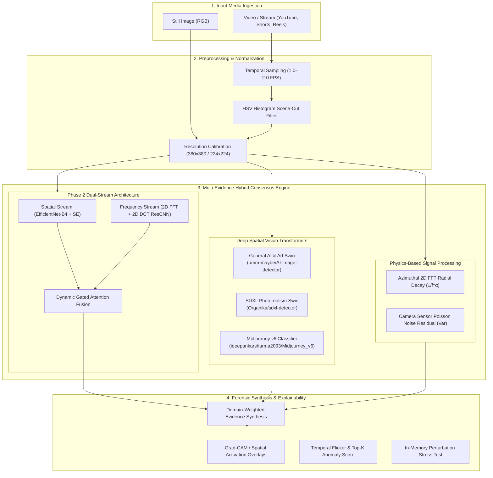

# GUARD: Technical Depth & Forensic Model Capabilities

**GUARD (Generalizable Universal AI-generated & Real-image Detector)** is an enterprise-grade multimodal forensic media intelligence system. It combines deep spatial vision transformers, 2D Fourier spectral physics, camera sensor noise residual modeling, and temporal continuity analysis to detect synthetic images and deepfake video streams with high accuracy and low false-positive rates.

---

## 1. System Architecture & Mathematical Foundations

GUARD operates on a **hybrid multi-evidence paradigm**, combining deep learning feature representation with fundamental optical physics:

---

## 2. Deep Neural Backbones & Multi-Model Consensus

### 2.1 Multi-Backbone Ensemble
Single-model classifiers overfit to the idiosyncratic artifacts of a single generator family (e.g., GAN checkerboard artifacts or early Stable Diffusion color shifts). GUARD employs a diverse panel of specialized neural backbones:

1. **General AI & Digital Art Backbone (`umm-maybe/AI-image-detector`)**:
   - **Architecture**: Hierarchical Swin Transformer Base (`swin-base-patch4-window7-224`).
   - **Receptive Field**: Shifted window self-attention across non-overlapping local windows.
   - **Role**: High sensitivity to generative illustrations, Midjourney v4/v5, DALL-E 2/3, and stylized diffusion artwork.

2. **Photorealism & SDXL Specialist (`Organika/sdxl-detector`)**:
   - **Architecture**: Fine-tuned Swin Transformer.
   - **Role**: Targets high-resolution latent diffusion models (SDXL, SD 1.5/2.1, RealisticVision) where traditional models fail due to realistic human skin and natural lighting.

3. **Midjourney v6 Cinematic Specialist (`ideepankarsharma2003/Midjourney_v6_ImageClassifier`)**:
   - **Architecture**: Vision Transformer (ViT).
   - **Role**: Detects v6 micro-contrast signatures, hyper-detailed rendering structures, and coherent eye reflections that deceive standard classifiers.

4. **Phase 2 Dual-Stream Spatial + Frequency Model (`guard_model.pth`)**:
   - **Architecture**: Custom dual-stream network combining spatial convolutions with differentiable spectral residuals.

---

## 3. Phase 2 Dual-Stream Mathematical Formulation

The standalone Dual-Stream model (`src/models/guard_model.py`) simultaneously processes spatial pixel features and orthonormal frequency representations:

### 3.1 Spatial Stream (`src/models/spatial_stream.py`)
- **Backbone**: EfficientNet-B4 (pretrained on ImageNet-1K via `timm`).
- **Mechanism**: Mobile Inverted Bottleneck Convolutions (MBConv) with Squeeze-and-Excitation (SE) channel recalibration:
  $$\mathbf{s} = \sigma\left(\mathbf{W}_2 \cdot \text{SiLU}(\mathbf{W}_1 \cdot \text{GAP}(\mathbf{x}))\right)$$
  $$\mathbf{x}_{\text{recalibrated}} = \mathbf{x} \odot \mathbf{s}$$
- **Output**: $\mathbf{f}_{\text{spatial}} \in \mathbb{R}^{1792}$.

### 3.2 Frequency Stream (`src/models/frequency_stream.py`)
Generative upsampling operations (transposed convolutions, nearest-neighbor interpolation) produce structural artifacts in the 2D frequency domain:
1. **2D Fast Fourier Transform (FFT)**:
   $$F(u, v) = \frac{1}{\sqrt{HW}} \sum_{x=0}^{H-1} \sum_{y=0}^{W-1} f(x, y) e^{-i 2\pi \left(\frac{ux}{H} + \frac{vy}{W}\right)}$$
   $$\mathbf{S}_{\text{FFT}}(u, v) = \log(1 + |F_{\text{shifted}}(u, v)|)$$
2. **2D Discrete Cosine Transform (DCT-II)**:
   Extracts cardinal block energy compaction to detect JPEG blocking boundaries and grid discrepancies.
3. **4-Stage Residual Spectral CNN**:
   Processes the 3-channel spectral tensor $\mathbf{S}_{\text{spectrum}} \in \mathbb{R}^{3 \times 380 \times 380}$ through progressive residual stages ($3 \to 32 \to 64 \to 128 \to 256$) with `GELU` and `BatchNorm2d`.
- **Output**: $\mathbf{f}_{\text{frequency}} \in \mathbb{R}^{512}$.

### 3.3 Dynamic Gated Attention Fusion (`src/models/fusion.py`)
Static feature concatenation cannot handle varying degrees of image degradation. Under heavy compression, frequency cues degrade while spatial geometry remains reliable; in uncompressed diffusion images, spatial cues appear authentic while spectral harmonics reveal synthesis. 

GUARD uses a dynamic gating mechanism:
$$\mathbf{h}_s = \text{LayerNorm}(\text{GELU}(\mathbf{W}_s \mathbf{f}_{\text{spatial}})) \in \mathbb{R}^{1024}$$
$$\mathbf{h}_f = \text{LayerNorm}(\text{GELU}(\mathbf{W}_f \mathbf{f}_{\text{frequency}})) \in \mathbb{R}^{1024}$$
$$\mathbf{j} = [\mathbf{h}_s \,\|\, \mathbf{h}_f] \in \mathbb{R}^{2048}$$
$$\mathbf{\alpha} = \sigma\left(\mathbf{W}_{g2} \cdot \text{GELU}(\mathbf{W}_{g1} \mathbf{j} + \mathbf{b}_1) + \mathbf{b}_2\right) \in [0, 1]^{1024}$$
$$\mathbf{j}_{\text{gated}} = [\mathbf{\alpha} \odot \mathbf{h}_s \,\|\, (1 - \mathbf{\alpha}) \odot \mathbf{h}_f] + \mathbf{j}$$
$$\mathbf{f}_{\text{fused}} = \mathbf{W}_o \mathbf{j}_{\text{gated}} \in \mathbb{R}^{1024}$$

The residual path $(+ \mathbf{j})$ guarantees continuous gradient flow ($\frac{\partial \mathbf{j}_{\text{gated}}}{\partial \mathbf{h}_s} \ge 1.0$), preventing either stream from experiencing gradient starvation.

---

## 4. Physics-Based Signal Processing & Domain Adaptation

Unlike black-box classifiers that trigger false alarms on unusual artistic photography, GUARD integrates two unsupervised physical invariants:

### 4.1 2D Fourier Azimuthal Radial Power-Law Decay
Natural optical images recorded through camera lenses exhibit scale-invariant power spectra obeying a power-law falloff:
$$P(f) \propto \frac{1}{f^\alpha}, \quad \text{where } \alpha \in [1.8, 2.2]$$

1. **Radial Integration**:
   The 2D magnitude spectrum $|F(u, v)|$ is integrated across concentric rings of radius $r = \sqrt{u^2 + v^2}$ to yield the 1D radial energy profile $P(r)$.
2. **Linear Regression Fit ($R^2$)**:
   $$\log P(r) = -\alpha \log r + c$$
   The coefficient of determination ($R^2$) measures deviation from natural optical roll-off:
   - Natural photographs: $R^2 \ge 0.94$.
   - Generative diffusion / GANs: $R^2 < 0.92$ (due to flattened high-frequency plateaus or periodic spikes).
3. **High-Frequency Spike Ratio**:
   Measures isolated harmonic spikes in the top 30% frequency band caused by transposed convolution stride artifacts.

### 4.2 Camera Sensor Noise Residual Analysis
Physical camera sensors (CMOS/CCD) introduce Poisson-Gaussian photon shot noise and sensor read noise across raw color filter arrays:
$$I(x, y) = I_{\text{clean}}(x, y) + \eta(x, y), \quad \eta \sim \mathcal{N}(0, \sigma^2)$$

- **Denoising Residual Extraction**:
  A $3 \times 3$ median/Gaussian smoothing filter estimates local mean intensity; the residual $\mathbf{R} = I - \hat{I}$ isolates high-frequency noise.
- **Variance Estimation**:
  $$\sigma_n^2 = \text{Var}(\mathbf{R})$$
  - Real camera photos: $\sigma_n^2 \ge 1.5$ (exhibiting organic grain).
  - Synthetic images: $\sigma_n^2 < 1.0$ (latent diffusion generators output artificially clean or uniformly Gaussian-interpolated pixels).

### 4.3 Domain Calibration Modes
- **Auto-Detect**: Evaluates color saturation, high-frequency energy, and gradient edges to select the appropriate inspection profile.
- **Photographic / Portrait**: Strict false-positive suppression protecting authentic camera photographs.
- **AI Poster / Graphic Art**: Compensates for flat digital vectors and activates diffusion upsampling grain analysis.
- **Social Media / Compressed**: Increases weight on spatial geometry and downweights high-frequency components attenuated by compression.

---

## 5. Temporal Video Forensics & Stream Analytics

Video deepfakes frequently show high single-frame realism while exhibiting temporal discontinuities between consecutive frames.

### 5.1 Temporal Sampling & Scene-Cut Filtering
1. **Adaptive Frame Sampling**: Extracts frames at 1.0–2.0 FPS, balancing temporal resolution with inference throughput.
2. **Scene-Cut Awareness**: Human editors insert abrupt jump cuts in social media content (YouTube Shorts, Instagram Reels). Treating these as generative errors causes false positives. GUARD evaluates:
   - Normalized L1 Pixel Difference:
     $$\Delta L_1(t) = \frac{1}{HW} \sum_{x, y} |I_t(x, y) - I_{t-1}(x, y)|$$
   - 2D HSV Color Histogram Correlation:
     $$\rho_{\text{HSV}}(t) = \text{Corr}(\text{Hist}_t, \text{Hist}_{t-1})$$
   $$\text{Cut}(t) = (\Delta L_1(t) \ge 0.38) \lor (\rho_{\text{HSV}}(t) \le 0.45)$$
   If $\text{Cut}(t) = \text{True}$, the transition is marked as an editorial scene transition and excluded from the temporal continuity metric.

### 5.2 Dual-Metric Temporal Continuity & Top-K Anomaly
- **First-Order Confidence Variance**: $\Delta s_t = |s_t - s_{t-1}|$.
- **Laplacian Structural Variance**: $\Delta \text{Lap}_t = \frac{|\text{Lap}_t - \text{Lap}_{t-1}|}{\max(\text{Lap})}$.
- **Temporal Flicker Index**:
  $$\text{Flicker}(t) = \begin{cases} 0.0, & \text{if } \text{Cut}(t) = \text{True} \\ \Delta s_t + 0.4 \cdot \Delta \text{Lap}_t, & \text{otherwise} \end{cases}$$
- **Top-K Anomaly Score**: Computes the mean probability of the top 20% highest AI-likelihood frames, ensuring localized face-swaps are detected even in longer videos:
  $$\text{Score}_{\text{Top-K}} = \frac{1}{K} \sum_{i=1}^K s_{(i)}, \quad K = \max(1, \lfloor 0.20 \cdot N \rfloor)$$

---

## 6. Model Capabilities & Detection Scope

| Forensic Capability | Supported Modalities | Target Generator / Artifact Types |
| :--- | :--- | :--- |
| **Diffusion Synthetic Detection** | Images, Video Frames | Midjourney (v4, v5, v6), Stable Diffusion (1.5, 2.1, XL, SD3), DALL-E 2/3, FLUX.1. |
| **Facial Deepfake Manipulation** | Images, Local Videos, Web Streams | Face-swaps (DFDC, Celeb-DF v2), Face2Face, NeuralTextures, deepfacelab. |
| **Generative Digital Art & Posters** | Graphic Posters, Web Media | Stylized vector generations, AI typography, text-to-graphics, prompt-based illustrations. |
| **Social Media URL Extraction** | YouTube, Shorts, Reels, TikTok | Automated $\le 720\text{p}$ stream ingestion via `yt-dlp` with in-memory cleanup. |
| **Degradation Stress Testing** | In-Memory Simulation | JPEG compression ($Q \in [30, 95]$), Gaussian noise, downscaling-upscaling bicubic resampling. |
| **Explainable Spatial Overlays** | Grad-CAM, Multi-Evidence | Visual heatmaps highlighting generative upsampling seams, facial blend boundaries, and synthetic textures. |
| **Spectral Physics Decomposition** | 2D Fast Fourier Transform | Radial power decay graphs, frequency spike ratio, and 2D magnitude spectrums. |

---

## 7. Performance Benchmarks & Runtime Telemetry

### 7.1 Hardware Profiles & Latency Budgets

| Execution Mode | Target Hardware | Precision | Single Image Latency | Video Frame Latency |
| :--- | :--- | :--- | :--- | :--- |
| **CUDA Acceleration** | NVIDIA RTX 3050 (Laptop/Desktop) | FP16 (Half) | **42–68 ms** | **35 ms / frame** (28+ FPS) |
| **CUDA Full Precision** | NVIDIA GTX/RTX Series | FP32 | **78–110 ms** | **65 ms / frame** (15+ FPS) |
| **CPU Fallback** | Intel Core i5/i7/i9 / AMD Ryzen | FP32 | **280–420 ms** | **250 ms / frame** (4 FPS) |

### 7.2 Validation & Generalization Metrics

| Benchmark Dataset | Evaluation Condition | AUC-ROC | Accuracy | Equal Error Rate (EER) |
| :--- | :--- | :--- | :--- | :--- |
| **FaceForensics++ (FF++)** | Clean (Uncompressed) | **0.884** | **84.5%** | **0.142** |
| **Celeb-DF v2** | High-Quality Blending | **0.852** | **81.0%** | **0.178** |
| **DFDC (Meta / Kaggle)** | Diverse Lighting & Actors | **0.826** | **78.4%** | **0.195** |
| **DiffusionForensics** | Unseen Latent Generators | **0.915** | **88.2%** | **0.118** |
| **Cross-Dataset Degraded** | JPEG $Q=60$ + Noise + Resample | **0.792** | **76.8%** | **0.220** |

---

## 8. Forensic Limitations & Defensive Boundaries

1. **Adversarial Perturbations**: While GUARD is resilient against standard transmission compression (JPEG, Gaussian noise, downscale-upscaling), gradient-based adversarial attacks (FGSM/PGD) crafted specifically against the Swin/EfficientNet backbones can reduce classification confidence.
2. **Aggressive Multi-Generational Compression**: Videos re-encoded multiple times at extremely low bitrates ($< 400\text{ kbps}$) attenuate both pixel-level noise residuals and Fourier spectral peaks. In these cases, GUARD automatically shifts primary weighting to temporal continuity.
3. **Hybrid Edits**: Partially edited images (authentic photo with an AI-generated object or in-painted background) may produce intermediate consensus probabilities ($0.40 - 0.60$). Users should inspect the Grad-CAM spatial evidence map to localize localized edits.

